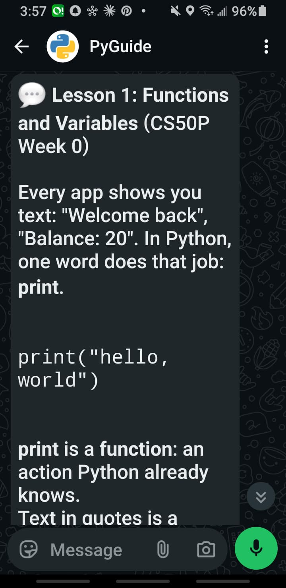
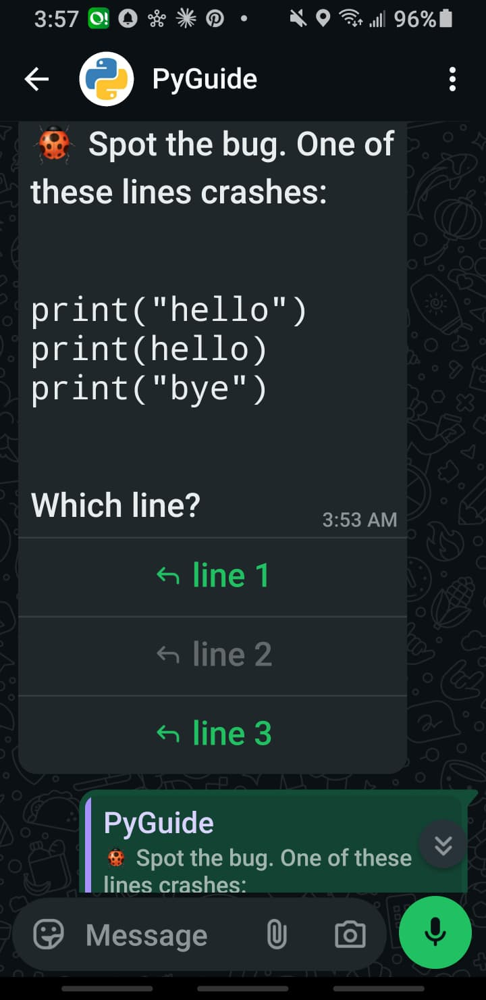
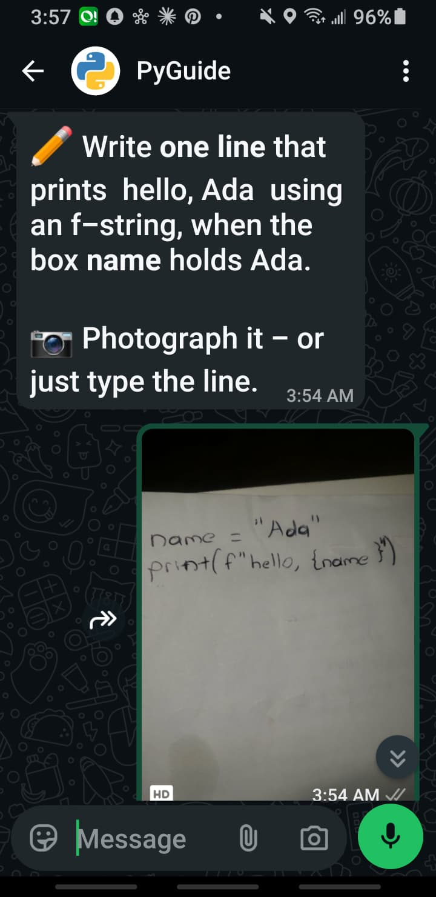
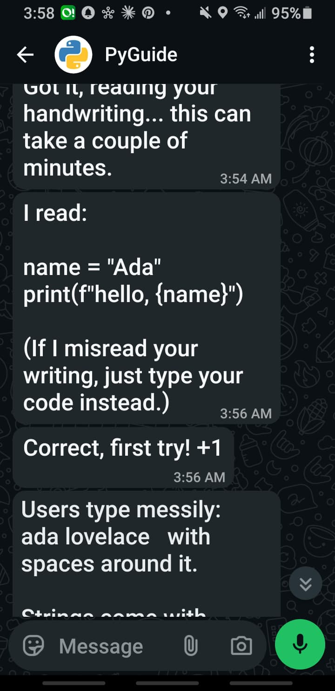

# PyGuide

A WhatsApp bot that teaches you Python with nothing but your phone, a pen and some paper.

  
  
  
  

## Why I built it

My friends wanted to learn programming and couldn't. One of them didn't have laptops. One of them did have laptops that can't run an IDE without making the
whole thing miserable. So they just stopped.

I made PyGuide for them and for people like them specifically. Nearly everyone has  WhatsApp is how people talk, so that's where the lessons live. You read a bit, write your code on paper, take a photo.

## What it does

- Five lessons that follow Harvard's free CS50P course.
- You write code on paper and send a photo. The bot reads it
- When you get something wrong and it tells you what you got wrong.
- Stuck? Type `ASK` and a question. The tutor gives hints,

## How it works

A Flask app on my PC gets the messages from Meta through asaved in SQLite. Two Ollama models running locally do theAI parts: `gemma3:4b` reads the handwritten code, `llama3.2` is the tutor.

One thing I learned the hard way: the model only reads the code, it doesn't mark it. Whether the code is right is decided by patterns in `lessons.py`. I tried letting the model grade directly and it passed wrong answers.

Everything runs on my own machine and costs me nothing.